# StudyFlow AI 🎓

> **Intelligent Study Companion & AI-Powered Learning Assistant**  
> An all-in-one AI learning platform that empowers students to study smarter through personalized AI tutoring, PDF document intelligence, automated study planning, diagnostic mock tests, interactive flashcards, and real-time performance analytics.

[](https://studyflow-frontenddd.onrender.com)
[](https://github.com/krishikajoshi/StudyFlow-AI)
[](https://react.dev/)
[](https://vitejs.dev/)
[](https://nodejs.org/)
[](https://expressjs.com/)
[](https://groq.com/)
[](LICENSE)

---

## 📌 Live Deployment & Repository

- **Live Application**: [https://studyflow-frontendd.onrender.com](https://studyflow-frontendd.onrender.com/)
- **GitHub Repository**: [https://github.com/krishikajoshi/StudyFlow-AI](https://github.com/krishikajoshi/StudyFlow-AI)

---

## 📑 Table of Contents

- [Overview](#-overview)
- [Problem Statement](#-problem-statement)
- [Key Features](#-key-features)
- [System Architecture](#-system-architecture)
- [Technologies Used](#-technologies-used)
- [Screenshots](#-screenshots)
- [Prerequisites](#-prerequisites)
- [Environment Variables](#-environment-variables)
- [Local Installation & Setup](#-local-installation--setup)
- [Running the Application](#-running-the-application)
- [Backend API Endpoints](#-backend-api-endpoints)
- [Deployment Guide](#-deployment-guide)
- [Future Roadmap](#-future-roadmap)
- [License & Authors](#-license--authors)

---

## 💡 Overview

**StudyFlow AI** is designed to address the challenges modern students face when tackling dense academic material, preparing for examinations, and maintaining consistent study habits. By combining client-side PDF document parsing with high-speed LLM inference via the **Groq API**, StudyFlow AI transforms passive lecture notes into an interactive, multi-dimensional learning environment.

Students can upload their lecture slides and textbook chapters, automatically extract foundational concepts, test their recall through generated practice quizzes, receive semantic AI evaluations on written answers, and follow structured, day-by-day study schedules personalized to their strengths and weaknesses.

---

## 🎯 Problem Statement

Traditional self-study methods suffer from several persistent friction points:
1. **Information Overload**: Modern syllabi require parsing hundreds of pages of complex slides and textbooks without instant guidance.
2. **Passive Reading vs. Active Recall**: Students often re-read notes passively instead of testing conceptual mastery through spaced repetition and practice challenges.
3. **Lack of Instant Feedback**: Practice exams often provide only an answer key without explaining *why* an alternative was incorrect or grading written reasoning.
4. **Disorganized Study Planning**: Students struggle to translate upcoming exam dates and course syllabi into realistic daily study schedules.
5. **Fragmented Tooling**: Flashcards, notes, calendars, and test preparation tools are scattered across disconnected apps.

**StudyFlow AI** unifies these critical workflows into a single cohesive platform.

---

## ✨ Key Features

### 📄 1. PDF Document Intelligence & Note Studio
- **Client-Side Text Extraction**: High-performance PDF parsing powered by `pdfjs-dist`, reading lecture slides and documents without file size limits.
- **AI Study Summaries**: Generates structured overviews, key concepts, definitions, formulas, and high-yield exam takeaways.
- **Conceptual Difficulty Analysis**: Identifies core topics and categorizes conceptual difficulty (`Easy`, `Medium`, `Hard`) with targeted study tips.
- **Automated MCQ Generation**: Generates 5 to 20 customizable practice multiple-choice questions with answer keys and detailed explanations.
- **Revision Sheets & Flashcards**: Generates concise last-minute revision guides and interactive question-and-answer flashcard decks.
- **Document Chunking & Sampling**: Backend safeguards handle large documents via sequential multi-chunk processing and representative sampling to respect model token limits.

### 🤖 2. Context-Aware AI Tutor
- **Dual-Mode Explanations**: Answers questions grounded directly in the student's uploaded lecture notes, or provides clear general academic explanations when no notes are selected.
- **Multi-Turn Chat History**: Maintains contextual conversation history for coherent, iterative follow-up questions.
- **Clean Markdown Formatting**: Renders mathematical formulas, lists, code snippets, and structural tables with high readability.

### 📅 3. Automated & Adaptive Study Planner
- **Targeted Milestone Scheduling**: Generates 3-to-30-day realistic daily study schedules based on subject, syllabus topics, and available daily minutes (15–240 mins).
- **Adaptive Personalization**: Ingests past mock test errors and identified misconceptions to prioritize weak concepts in early milestones.
- **Task Categorization**: Assigns concrete task types (`learn`, `revise`, `practice`, `assessment`) with realistic time budgets and priority tags (`High`, `Medium`, `Low`).
- **Progress Tracking**: Interactive task completion checklist with automatic progress bars.

### 📝 4. Diagnostic Mock Tests & Written Evaluator
- **Dual Question Formats**: Supports both Multiple-Choice Questions (MCQs) and Written / Conceptual explanation questions.
- **Real-Time Exam Simulator**: Timed test environment with question jump navigation, answer review flags, and submission confirmation.
- **AI Written Grading**: Evaluates student written responses using rubric-based semantic grading, providing percentage scores, identified misconceptions, strengths, and targeted improvement notes.
- **Historical Performance Records**: Persists every attempt with question-level diagnostic reviews.

### 🧠 5. Interactive Revision & Flashcards
- **Animated Flashcard Deck Player**: Interactive 3D flip card interface for front/back active recall drills.
- **Self-Assessment Scoring**: Rate cards as `Easy`, `Medium`, or `Hard` to calculate deck mastery percentages.
- **Course Linking**: Organizes flashcard decks by subject for quick retrieval before exams.

### 📚 6. Course & Workspace Management
- **Course Organization**: Group notes, mock tests, and study plans by course with custom color coding and exam deadline countdowns.
- **Unified Quick Creation Modal**: Global workspace action to upload notes, create courses, build mock tests, or generate study plans from any screen.

### 📊 7. Analytics & Goal Tracking
- **Aggregated Platform Metrics**: Tracks total study time, practice sessions, average test accuracy, completed goals, and flashcards mastered.
- **Custom Goal Setting**: Set and track goals across study time, quiz completions, and test targets with progress bars and automated completion updates.
- **Recent Learning Activity Feed**: Real-time event logging capturing all learning milestones.

---

## 🏗️ System Architecture

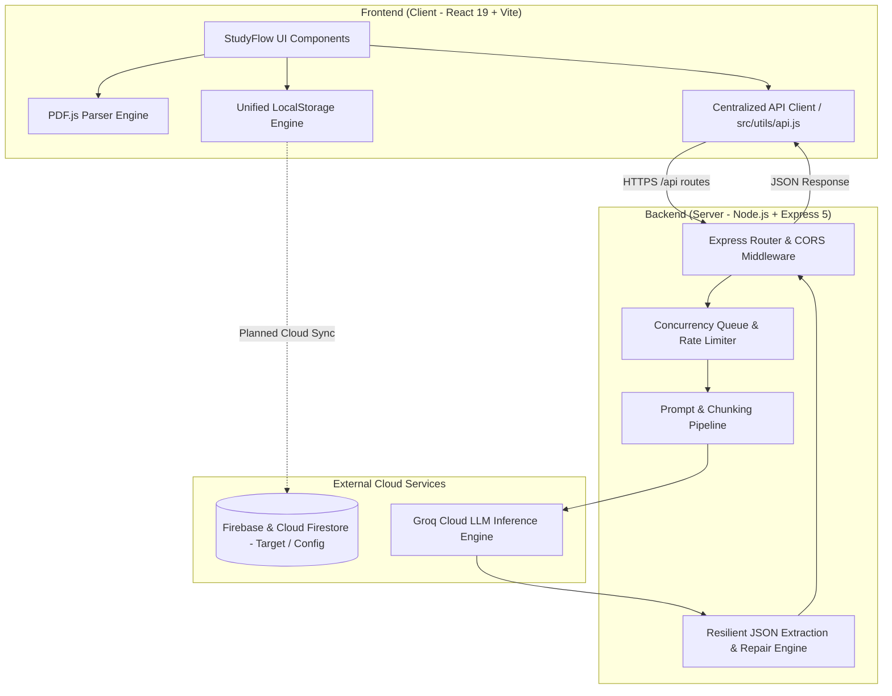

### Architectural Highlights
1. **Frontend**: Component-driven architecture using React 19, Vanilla CSS design tokens with glassmorphism and dark mode, and client-side PDF text extraction via Web Workers.
2. **Backend**: Express 5 REST API featuring concurrency serialization (`requestQueue`), rate-limit backoff handling, and fault-tolerant JSON parsers capable of repairing malformed LLM outputs.
3. **AI Pipeline**: Groq SDK integration leveraging high-speed inference models with dynamic prompt templates tailored for pedagogical clarity.

---

## 🛠️ Technologies Used

| Layer | Technology | Purpose |
| :--- | :--- | :--- |
| **Frontend Framework** | [React 19](https://react.dev/) | Component architecture, state management, and UI rendering |
| **Build Tool** | [Vite 8](https://vitejs.dev/) | Next-generation frontend tooling and rapid HMR development |
| **Styling** | Vanilla CSS3 | Custom design system, glassmorphism, responsive grid & flexbox layouts |
| **PDF Extraction** | [PDF.js (`pdfjs-dist`)](https://mozilla.github.io/pdf.js/) | In-browser PDF document parsing and text extraction |
| **Markdown Rendering** | [`react-markdown`](https://github.com/remarkjs/react-markdown) + [`remark-gfm`](https://github.com/remarkjs/remark-gfm) | Formatting AI responses with tables, code blocks, and math definitions |
| **Backend Framework** | [Node.js](https://nodejs.org/) & [Express 5](https://expressjs.com/) | RESTful API server, routing, and middleware processing |
| **AI Inference** | [Groq SDK](https://console.groq.com/) | Ultra-low latency LLM inference for text generation and evaluation |
| **Database & Auth** | LocalStorage Engine *(Planned: Firebase / Cloud Firestore)* | Unified persistent state engine for courses, notes, tests, and goals |
| **CORS & Environment** | `cors`, `dotenv` | Secure cross-origin resource sharing and environment management |
| **Hosting & Deployment**| [Render](https://render.com/) / [Vercel](https://vercel.com/) | Cloud deployment for containerized backend and static frontend |
| **Version Control** | [Git](https://git-scm.com/) & [GitHub](https://github.com/) | Source code management and CI/CD deployment triggers |

---

## 📸 Application Screenshots

Explore the key features and user interface of StudyFlow AI across all core modules:

### 1. Workspace & Curriculum Management
| Overview Dashboard | Curriculum & Course Manager |
| :---: | :---: |
| 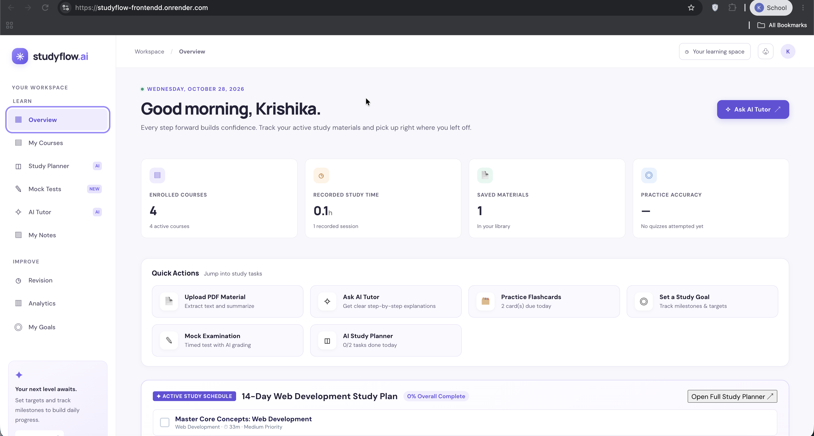 | 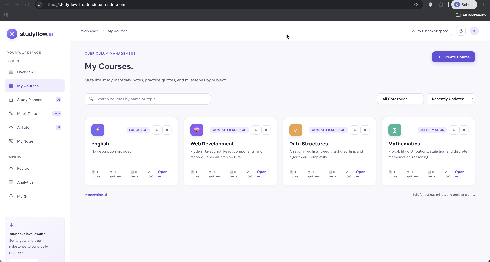 |
| *Real-time metrics, active study schedule, and quick-launch action cards* | *Course catalog, subject tags, progress tracking, and module organization* |

| Course Creation Studio |
| :---: |
| 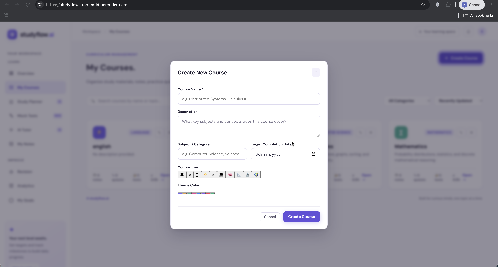 |
| *Modal interface for establishing courses with syllabus topics and difficulty ratings* |

### 2. AI Study Planner & Automated Scheduling
| AI Study Plan Generator | Curriculum Schedule & Milestones |
| :---: | :---: |
| 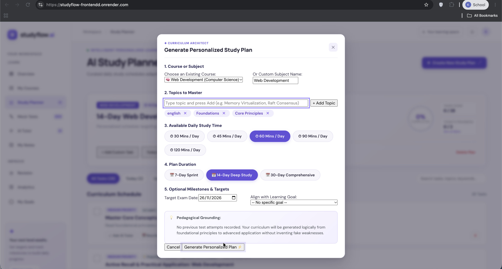 | 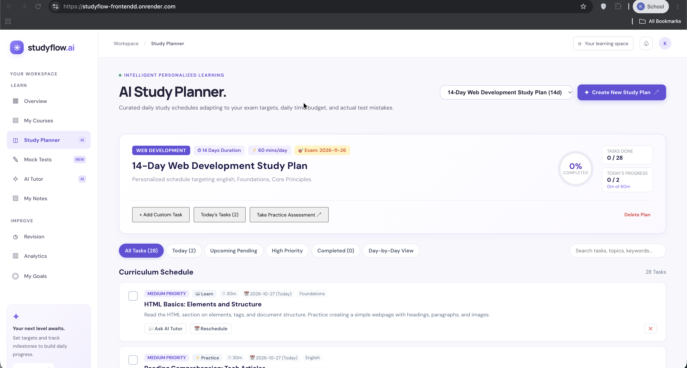 |
| *AI wizard configuring exam dates, daily study commitment, and custom target topics* | *Daily task breakdown with priority badges, time estimates, and completion toggles* |

### 3. Diagnostic Mock Examinations
| Mock Exam Configuration | Live Exam Simulator |
| :---: | :---: |
| 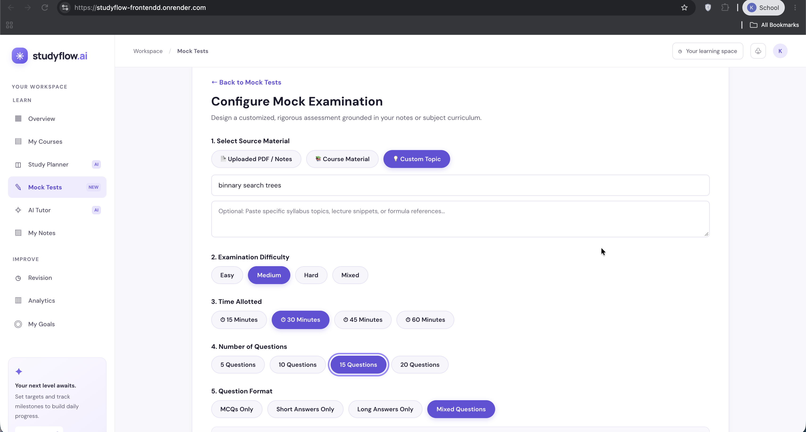 | 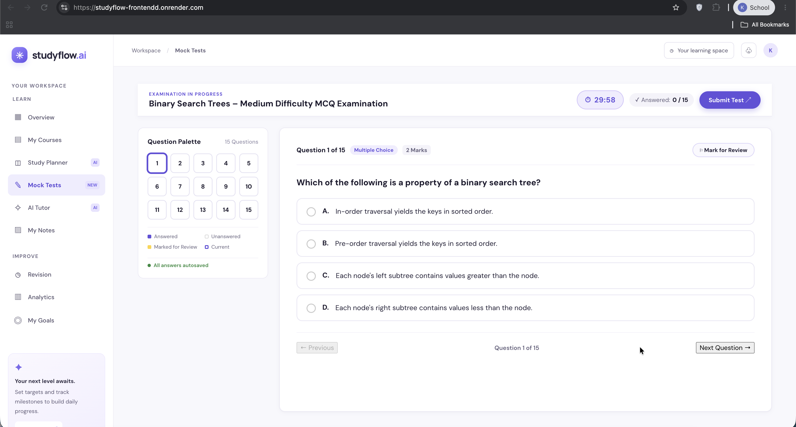 |
| *Customizable exam generator with question count, difficulty levels, and timer settings* | *Real-time timed assessment with interactive question palette and instant response capture* |

### 4. Interactive AI Tutor
| AI Pedagogical Tutor |
| :---: |
| 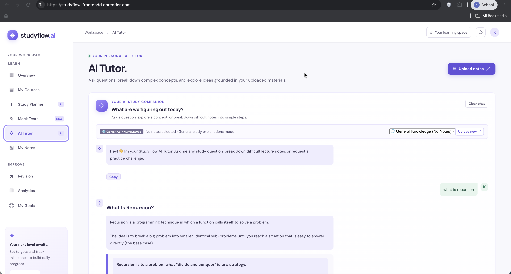 |
| *Context-aware chat assistant providing step-by-step explanations, code examples, and study guidance* |

### 5. Document Studio, AI Summaries & Quizzes
| PDF Ingestion & Extraction | AI Conceptual Summary |
| :---: | :---: |
| 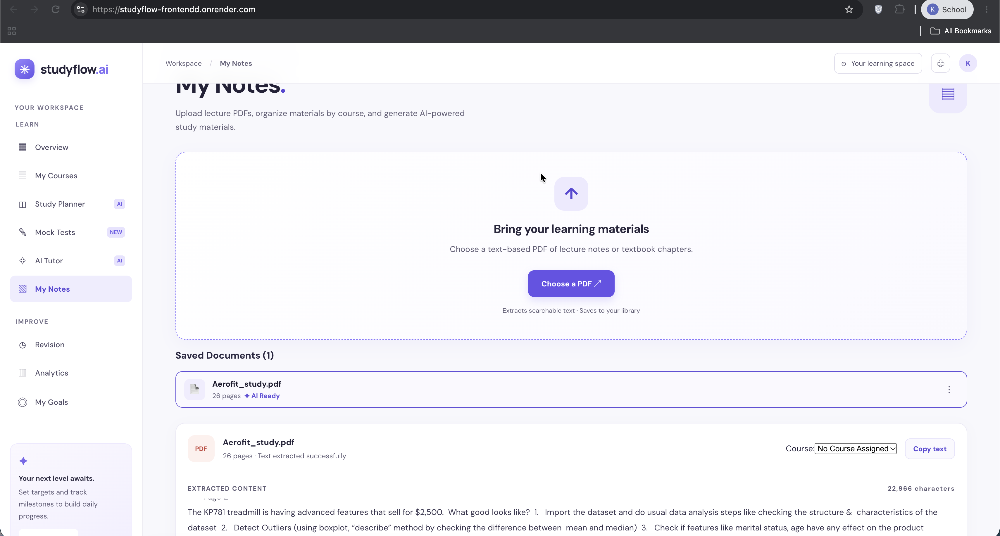 | 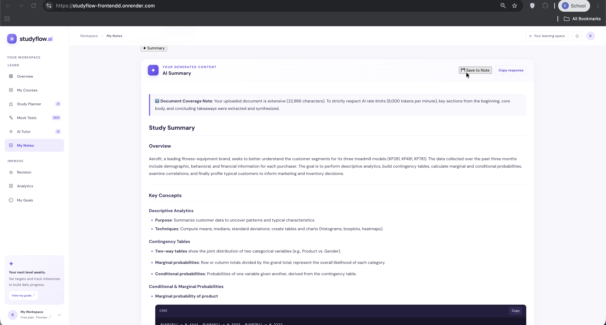 |
| *Client-side PDF text extraction and document inspection workspace* | *Structured study summaries synthesizing key definitions, concepts, and code blocks* |

| Generated Practice Quiz |
| :---: |
| 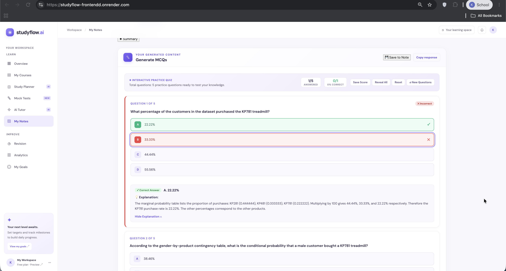 |
| *Contextual AI-generated quizzes featuring instant grading, explanation cards, and answer review* |

### 6. Active Recall & Revision Hub
| Spaced Repetition Flashcards | Saved Summaries & Document Vault |
| :---: | :---: |
| 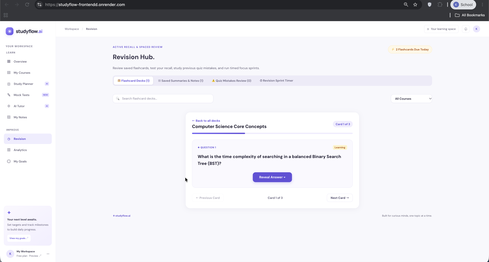 | 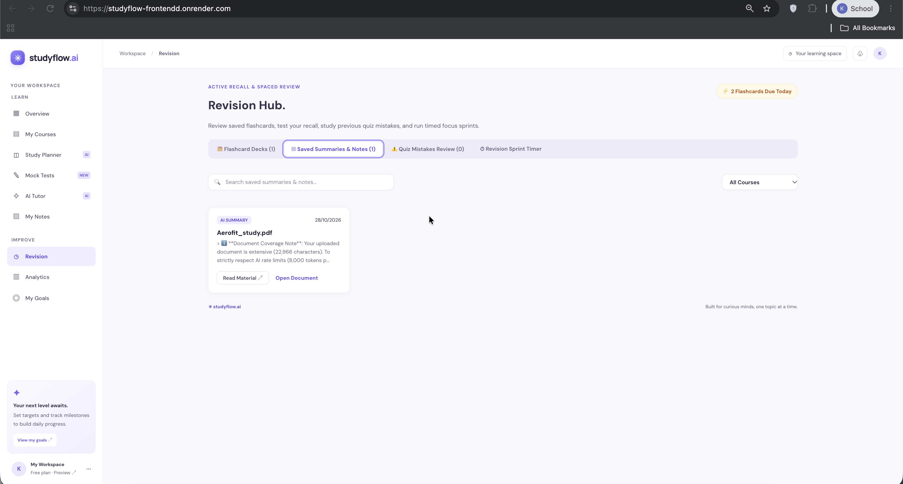 |
| *Interactive flashcard player with question reveal and active recall self-assessment* | *Centralized repository indexing all generated notes, summaries, and source documents* |

| Pomodoro Focus Sprint Timer |
| :---: |
| 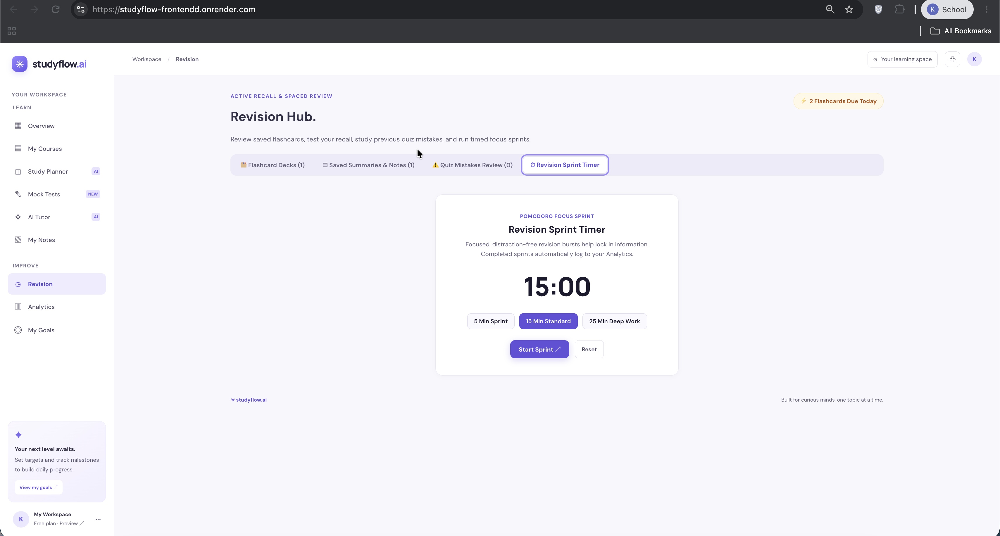 |
| *Configurable focus sprint timer (5 min, 15 min, 25 min) directly connected to learning analytics* |

### 7. Learning Analytics & Goals Tracking
| Learning Analytics Dashboard | Goals & Milestone Tracker |
| :---: | :---: |
| 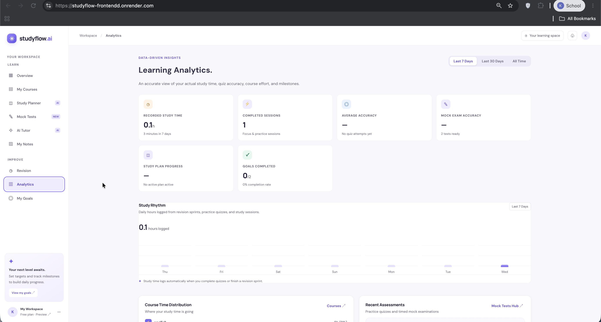 | 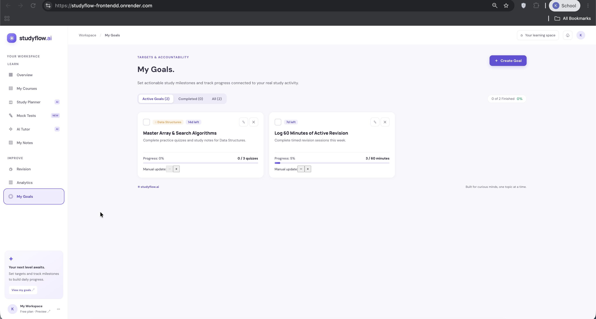 |
| *Comprehensive study metrics, accuracy trends, session logs, and weekly study rhythm charts* | *Target tracking dashboard with quiz milestones, deadlines, and progress bars* |

---

## 📦 Prerequisites

Before running the project locally, ensure you have the following installed on your machine:
- **Node.js**: Version `18.0.0` or higher (recommended: LTS Node 20+)
- **npm**: Version `9.0.0` or higher (comes bundled with Node.js)
- **Groq API Key**: A valid API key from [Groq Console](https://console.groq.com/)

---

## 🔐 Environment Variables

### Backend Configuration (`server/.env`)
Create a `.env` file in the `server/` directory:

```env
# Required: Your Groq API key from https://console.groq.com/keys
GROQ_API_KEY=gsk_your_groq_api_key_here

# Optional: Server listening port (defaults to 3001 if omitted)
PORT=3001

# Optional: AI model override (defaults to openai/gpt-oss-20b or llama-3.3-70b-versatile)
GROQ_MODEL=openai/gpt-oss-20b
```

### Frontend Configuration (`.env` in root)
Create a `.env` file in the root project directory (optional for local development, as the Vite dev server proxies `/api` requests automatically):

```env
# Optional in dev (uses relative /api proxy); required in production if backend is on a separate domain
VITE_API_URL=http://localhost:3001
```

> ⚠️ **Security Warning**: Never commit `.env` files containing real API keys or credentials to Git. Both `.env` and `server/.env` are included in `.gitignore`.

---

## 🚀 Local Installation & Setup

### 1. Clone the Repository
```bash
git clone https://github.com/krishikajoshi/StudyFlow-AI.git
cd StudyFlow-AI
```

### 2. Install Frontend Dependencies
From the root project directory:
```bash
npm install
```

### 3. Install Backend Dependencies
Navigate to the `server/` directory and install dependencies:
```bash
cd server
npm install
cd ..
```

### 4. Configure Environment Variables
Create the backend environment file:
```bash
cp server/.env.example server/.env
# Open server/.env and insert your GROQ_API_KEY
```

---

## 💻 Running the Application

To run StudyFlow AI locally, you need to run both the backend server and frontend development server.

### Option A: Running in Two Terminal Windows

#### Terminal 1 — Start Backend Server:
```bash
cd server
npm start
```
*The backend server will start at `http://localhost:3001`.*

#### Terminal 2 — Start Frontend Development Server:
```bash
# In the root project directory:
npm run dev
```
*The frontend Vite development server will start at `http://localhost:5173`.*

### Option B: Building for Production
To build the frontend bundle and preview it locally:
```bash
# Build the production bundle
npm run build

# Preview the production build locally
npm run preview
```

---

## 🔌 Backend API Endpoints

All backend endpoints are prefixed with `/api` and accept/return `application/json`:

| Method | Endpoint | Description | Payload Parameters |
| :--- | :--- | :--- | :--- |
| `GET` | `/` | Root server status | None |
| `GET` | `/api/health` | Health check endpoint | None |
| `POST` | `/api/ai` | Note intelligence endpoint | `{ task: "summarize"\|"topics"\|"mcqs"\|"revision"\|"flashcards"\|"ask", text: string, question?: string, count?: number }` |
| `POST` | `/api/tutor` | Dedicated AI tutor chat | `{ question: string, history: Array<{role, text}>, documentText?: string }` |
| `POST` | `/api/mock-test/generate` | Generates a full practice exam | `{ subject: string, topic: string, questionCount: number, difficulty: string, notesText?: string }` |
| `POST` | `/api/mock-test/evaluate` | Evaluates written student answers | `{ testId: string, writtenAnswers: Array<{questionId, question, studentAnswer, rubric}> }` |
| `POST` | `/api/study-planner/generate`| Generates adaptive daily study plans | `{ subject: string, topics: string[], dailyMinutes: number, durationDays: number, targetExamDate?: string, assessmentHistory?: object }` |

---

## ☁️ Deployment Guide

### Deploying the Backend on Render
1. Log into your [Render Dashboard](https://dashboard.render.com/).
2. Click **New +** $\rightarrow$ **Web Service**.
3. Connect your GitHub repository: `krishikajoshi/StudyFlow-AI`.
4. Configure the service settings:
   - **Name**: `studyflow-api`
   - **Root Directory**: `.` *(leave blank or repository root)*
   - **Environment**: `Node`
   - **Build Command**: `cd server && npm install`
   - **Start Command**: `cd server && npm start`
5. In **Environment Variables**, add:
   - `GROQ_API_KEY`: `your_actual_groq_api_key`
   - `PORT`: `10000` *(Render sets this automatically)*
6. Click **Deploy Web Service**.

### Deploying the Frontend on Render or Vercel
1. Create a new **Static Site** on Render or import project on **Vercel**.
2. Configure build settings:
   - **Build Command**: `npm run build`
   - **Publish Directory**: `dist`
3. Add the environment variable:
   - `VITE_API_URL`: URL of your deployed backend (e.g. `https://your-backend-service.onrender.com`)
4. Deploy the site.

---

## 🔮 Future Roadmap

- [ ] **Cloud Database Synchronization**: Integrate Firebase Authentication & Cloud Firestore to persist student workspaces and notes across multiple devices.
- [ ] **Multi-Modal Notes Support**: Support handwriting recognition and image-based formula extraction from lecture photos.
- [ ] **Collaborative Study Rooms**: Real-time shared flashcard sessions and multiplayer mock test challenges.
- [ ] **Calendar Export**: Export generated study plans directly to Google Calendar and Apple Calendar via `.ics` feeds.
- [ ] **Voice-Enabled AI Tutor**: Interactive audio voice conversations for verbal revision drills.

---

## 📄 License & Authors

This project is licensed under the **ISC License**.

- **Author**: Krishika Joshi ([@krishikajoshi](https://github.com/krishikajoshi))
- **Live Demo**: [https://studyflow-frontendd.onrender.com](https://studyflow-frontendd.onrender.com/)
- **Repository**: [https://github.com/krishikajoshi/StudyFlow-AI](https://github.com/krishikajoshi/StudyFlow-AI)
